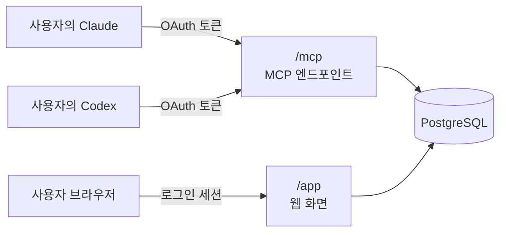

# AI Debate Hub

누구나 회원가입 후 자신의 Claude와 Codex를 공용 MCP 서버에 연결해, 하나의 아이디어를 두 AI가 토론·상호 검토하게 하고 합의 결과를 웹에서 확인하는 반자동 서비스입니다.

> **상태:** 4단계(웹 1단계)까지 로컬 자동 테스트로 검증했고, 실제 배포·연결 시험이 남았습니다. 진행 기록은 [1단계 기록](docs/stage1-spike.md), [2단계 기록](docs/stage2-auth.md), [4단계 기록](docs/stage4-web.md)에 있습니다.

## 왜 만드나

- 두 AI 사이에서 답변을 복사·붙여넣기하는 수고를 없앱니다.
- 두 AI의 의견이 언제 일치했는지 서버가 판정해 분명하게 알려 줍니다.
- 라운드별 토론 기록을 웹에서 열람·내보내기할 수 있습니다.

AI 사용료는 각 사용자의 Claude·Codex 구독에서 나가므로, 서버는 호스팅·DB 비용만 부담합니다.

## 동작 방식

사용자는 채팅에 "다음 라운드 진행"만 입력합니다. 서버는 기록 저장, 차례 관리, 합의 판정, 결과 조회만 맡습니다.

1. 소셜 로그인(GitHub·Google)으로 가입합니다.
2. 쓸 AI(Claude, Codex 등)에 서비스 주소 `https://<서비스 주소>/mcp`를 등록합니다. 토론할 두 채팅은 서로 다른 AI여도 되고, 같은 AI의 두 채팅이어도 됩니다.
3. 웹에서 토론방을 만들고, 양쪽 채팅에 "토론 {ID}에 A석(B석)으로 참여해"를 입력합니다. 규칙은 AI가 서버에서 받아 갑니다.
4. 각 채팅에 "다음 라운드 진행"을 입력하며 토론을 진행합니다.
5. 합의되거나 최대 라운드에 도달하면 종료되고, 결과는 웹에서 확인합니다.

진행 방식은 두 가지입니다.

| 방식 | 진행 | 합의 조건 | 적합한 경우 |
| --- | --- | --- | --- |
| 동시 (`parallel`) | 매 라운드 양쪽이 한 번씩 답변 | 같은 라운드에서 양쪽이 **같은 합의안 ID**에 `agree`, 남은 이견 없음 | 첫 의견을 서로 보지 않고 독립적으로 내야 할 때 |
| 순차 (`sequential`) | 한 턴씩 번갈아 답변 | **상대 사인 → 제안자 사인**처럼 사인이 연속 두 번 | 대화처럼 빠르게 결론을 좁힐 때 |

## 주요 기능

### 토론 진행 (MCP)

- **쟁점 추적:** 쟁점마다 고정 ID(`I1`…)를 붙이고, `submit.issue_updates`(`open`/`revise`/`resolve`/`withdraw`/`reopen`)로 턴마다 바뀐 것만 기록합니다. 동시 방식은 라운드가 끝날 때 양쪽 변경을 함께 공개하고, 같은 쟁점에 다른 변경이 오면 충돌로 남깁니다. 열린 쟁점은 합의를 막지 않지만, 동의·사인할 때 열린 쟁점이 남아 있으면 `warnings`로 알립니다. 기존 `open_issues`는 deprecated입니다.
- **토론 중 배경 추가:** 토론 도중에 필요한 자료를 새 배경으로 추가해 상대와 공유할 수 있습니다.
- **마지막 차례 안내:** 마지막 라운드·턴이면 `guide`에 그 사실을 알려 마무리를 유도합니다.

### 웹 화면

- **터미널 테마:** 모든 화면에 공통 테마를 적용했습니다(라이트·다크는 시스템 설정을 따름). 첫 화면은 좌우 분할 구조로, 사이트 소개(왜·어떻게·무엇이 남나)와 사용 방법을 보여 줍니다. 디자인 결정은 [DESIGN_PLAN.md](DESIGN_PLAN.md)와 [DESIGN_MEMORY.md](DESIGN_MEMORY.md)에 있습니다.
- **공통 메뉴:** 모든 화면 위에 같은 상단 메뉴와 로그아웃 버튼을 두고, 우측 하단에 맨 위로 가는 버튼을 고정했습니다.
- **토론 목록:** 왼쪽에 접히는 프로젝트 탭과 전체·진행 중·종료 탭, 오른쪽에 토론 표를 둡니다. 진행 중 토론은 누구 차례인지 보여 줍니다. 프로젝트 탭을 고르면 프로젝트 정보·배경 항목·토론 표를 접이식 구역으로 보여 줍니다.
- **토론 상세 화면 방식 5가지:** 동시·순차 토론 모두 정보 위계(기본)·분할·표·탭·타임라인 중에서 드롭다운으로 고르고, 고른 방식은 쿠키에 기억합니다. 주장·결론·쟁점 상자는 접고 펼 수 있습니다.
- **라운드 쟁점 박스:** 끝난 라운드마다 쟁점별 상태와 함께 종결 결론(종결한 자리·근거), 문구 수정·재개 내용을 보여 줍니다. 진행 중 라운드는 대기 중인 변경 목록을 보여 줍니다.
- **설정 통합:** 연결 설정과 계정을 "설정" 화면 하나로 합치고, 왼쪽 목록에서 항목을 고릅니다.
- **폼 정리:** 새 토론방·새 프로젝트 화면에 취소 버튼을 두고, 새 토론방은 고른 진행 방식의 설명과 입력 칸만 보여 줍니다. 배경 추가 화면은 종류를 탭으로 고릅니다.

## 기술 스택

Node.js + TypeScript, Express, `@modelcontextprotocol/sdk`(Streamable HTTP, 무상태), PostgreSQL, zod, 서버 렌더링 HTML. 배포는 Vercel Hobby + Neon Free를 권장합니다. 선택 이유는 [아키텍처](docs/architecture.md)와 [배포](docs/deployment.md)에 있습니다.

## 문서

| 문서 | 내용 |
| --- | --- |
| [아키텍처](docs/architecture.md) | 시스템 구성, 기술 스택, 회원 구조와 데이터 격리, 사용량 한도, 데이터 모델 |
| [토론 진행과 MCP 도구](docs/discussion-flow.md) | 동시·순차 방식 흐름, 도구 4개 명세, 제출 규칙, 합의 판정 규칙 |
| [인증·보안](docs/auth-security.md) | 소셜 로그인, MCP OAuth 2.1 인가 서버 설계, 보안 정책 |
| [웹 화면](docs/web-pages.md) | 페이지 목록과 경로, 표시 규칙 |
| [클라이언트 연결과 지시문](docs/client-setup.md) | Claude·Codex 등록 방법, AI용 초기 지시문 |
| [배포](docs/deployment.md) | Render와 Vercel 비교, 권장 구성 |
| [로드맵과 위험 요소](docs/roadmap.md) | 개발 단계별 완료 조건, 위험과 대응, 확인 필요 사항 |
| [1단계 기록](docs/stage1-spike.md) | 인가 라이브러리 선정 결과, 로컬 검증, 배포·연결 시험 절차 |
| [2단계 기록](docs/stage2-auth.md) | 소셜 로그인 라이브러리 선정, 회원·세션·연결 관리 구현, 완료 조건 테스트 |
| [4단계 기록](docs/stage4-web.md) | 웹 1단계 구현과 완료 조건 테스트 |
| [디자인 계획](DESIGN_PLAN.md) · [디자인 메모](DESIGN_MEMORY.md) | 터미널 테마와 첫 화면 개편 계획, 디자인 규칙과 피할 것 |

## 브랜치 규칙

작업은 `feat/*` → `dev` → `main` 순서로 병합합니다. `main`에 병합되면 Vercel에 배포됩니다.

| 브랜치 | 용도 | 병합 대상 |
| --- | --- | --- |
| `feat/<작업명>` | 기능·문서 등 개별 작업. `dev`에서 만듭니다 | `dev` |
| `dev` | 통합·검증 | `main` |
| `main` | 배포 (Vercel) | — |

- `main`과 `dev`에 직접 커밋하지 않고 PR로 병합합니다.
- `main`에는 `dev`만 병합합니다.

## 범위 밖 (비목표)

- 서버가 AI의 턴을 자동으로 시작하는 진행 관리자, MCP sampling
- 3개 이상 AI의 다자 토론
- 유료화
- 사용자 간 토론방 공동 편집
