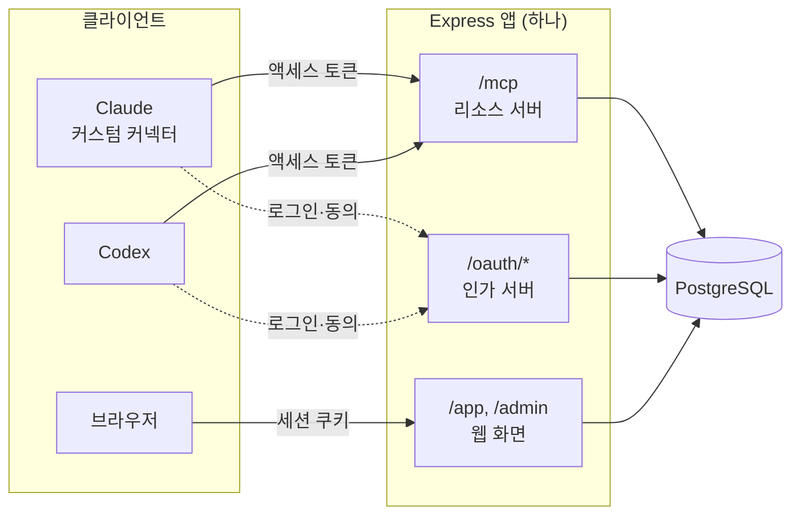

# 아키텍처

Express 앱 하나에 MCP 엔드포인트와 웹 화면을 함께 두고, 상태는 모두 PostgreSQL에 저장하는 단순 구조입니다.

## 시스템 구성

- 각 사용자의 Claude와 Codex는 OAuth 액세스 토큰을 담아 같은 `/mcp` 주소를 호출합니다.
- 서버는 토큰 하나로 "어느 사용자의 어느 AI인지"를 판별합니다.
- 사용자는 `/app` 웹 화면에서 자기 토론방을 만들고 기록을 조회합니다.

## 기술 스택

| 영역 | 선택 | 이유 |
| --- | --- | --- |
| 언어·런타임 | Node.js + TypeScript | 공식 MCP TypeScript SDK가 가장 성숙 |
| MCP | `@modelcontextprotocol/sdk` (Streamable HTTP, 무상태) | Claude·Codex 모두 지원하는 전송 방식 |
| 웹 | Express | Vercel이 공식 지원, Render로도 이전 가능 ([Vercel Express 안내](https://vercel.com/docs/frameworks/backend/express)) |
| 회원 인증 | Arctic(GitHub·Google OAuth 클라이언트) + 직접 만든 DB 세션 ([2단계 기록](stage2-auth.md)) | 비밀번호·메일 인프라 불필요, 서버리스 인스턴스 간 세션 공유 |
| MCP 인가 서버 | 같은 앱에 OAuth 2.1 인가 서버 내장 (`oidc-provider`, [1단계 기록](stage1-spike.md)) | 별도 인증 서비스 없이 무료 호스팅 하나로 운영 |
| 입력 검증 | zod | 도구 입력 스키마와 검증을 한 번에 정의 |
| DB | PostgreSQL (`pg` 또는 Drizzle) | 행 잠금·트랜잭션·유니크 제약 활용 |
| 웹 화면 | 서버 렌더링 HTML + marked + sanitize-html | 별도 프론트엔드 불필요, AI 본문을 안전하게 렌더링 |
| 테스트 | MCP Inspector, Vitest | 클라이언트 없이 OAuth 흐름, 도구 동작, 동시성, 사용자 간 격리 검증 |

## 회원 구조

- 1단계는 GitHub·Google 소셜 로그인만 제공합니다. 비밀번호 저장, 이메일 인증, 재설정 메일 인프라가 필요 없습니다.
- 이메일·비밀번호 가입은 후순위입니다. 필요해지면 메일 발송 서비스와 함께 추가합니다.
- 역할은 `user`와 `admin` 2개입니다. `admin`은 운영자 본인 계정에만 DB에서 직접 부여합니다.

MCP 연결(OAuth 2.1) 설계는 [인증·보안](auth-security.md)에 있습니다.

## 데이터 격리 규칙

1. 모든 토론방은 `owner_id`를 가집니다. 웹 화면과 MCP 도구의 모든 조회·수정에 `owner_id = 현재 사용자` 조건을 넣습니다.
2. MCP 도구에 다른 사용자의 `discussion_id`를 넣으면 "존재하지 않음"으로 응답합니다. 토론방이 있는지도 드러내지 않습니다.
3. 토론 ID는 추측하기 어려운 랜덤 값(12자 이상)으로 발급합니다.
4. 데이터 접근은 사용자 범위를 강제하는 저장소 함수 한 곳으로만 합니다. 다른 사용자 접근 차단은 테스트로 고정합니다.

## 사용량 한도

무료 DB 용량을 보호하고 남용을 막기 위한 기본값입니다.

| 항목 | 기본 한도 |
| --- | --- |
| 진행 중인 토론방 | 사용자당 5개 |
| 보관 토론방(종료 포함) | 사용자당 최대 50개, 텍스트 합계 5MB(5,000,000바이트)를 생성 시 검사. 한도 도달 시 종료 토론 삭제를 안내하고 새 생성 차단. 진행 중 토론의 추가 제출은 허용 |
| 토론방 생성 | 사용자당 하루 20개 |
| 제출 | 사용자 단위 분당 10회, 하루 300회. 토큰 갱신으로 우회되지 않도록 사용자·연결 단위로 계산 |
| 입력 길이 | 주제 200자, 배경 설명 2,000자, 본문 8,000자, 합의안 4,000자, `open_issues` 10개×200자 |
| 프로젝트 | 사용자당 10개. 이름 100자, 설명 2,000자 |
| 배경 항목 | 프로젝트당 30개(삭제되지 않은 항목만 셈). 제목 100자, 요약 300자, text 본문 50,000자, 위치 2,000자. 추가·수정은 하루 100회 |
| 보존 기간 | 종료 후 180일이 지난 토론방은 자동 삭제 (삭제 30일 전 화면 안내) |

### 한도 계산과 동시 요청

- 웹과 MCP의 토론 생성은 같은 저장소 함수를 사용합니다. 생성 트랜잭션에서 해당 `users` 행을 `SELECT … FOR UPDATE`로 잠근 뒤 진행 중 개수·보관 개수·텍스트 용량을 검사하고 생성합니다. 생성으로 5개·50개를 넘기거나 주제·배경 추가로 5MB를 넘기면 거부합니다.
- 텍스트 용량은 토론의 `topic`·`context`, 모든 답변의 `content`·`proposal`·`open_issues` 문자열, 쟁점 이벤트의 `text`·`note`(캐시 `issues.title`은 중복이라 제외), 배경 항목의 제목·요약·본문·위치를 UTF-8로 인코딩한 바이트 수의 합계입니다. 소프트 삭제된 배경도 저장 공간을 쓰므로 셉니다. 계정 화면(`usageOf`)과 운영자 화면(`listUsersWithUsage`)은 같은 SQL 식(`usageBytesSql`)을 씁니다. 글자 수, DB 행·인덱스 용량, JSON 구분자 크기는 이 한도와 구분합니다.
- 용량은 생성 시점에만 검사합니다. 이미 진행 중인 토론은 5MB를 넘어도 정해진 최대 라운드·턴까지 제출할 수 있습니다. 별도의 엄격한 제출별 용량 잠금은 두지 않습니다.
- 한 토론의 제출은 동시 방식 최대 10라운드×2명, 순차 방식 최대 20턴으로 모두 최대 20건입니다. 제출 텍스트는 최대 `20 × (8,000 + 4,000 + 10 × 200) = 280,000자`이고 주제·배경은 별도입니다. 바이트 수는 문자에 따라 다릅니다. 이 초과 허용량은 진행 중 최대 5개에 누적될 수 있으므로 5MB는 사용자별 DB 사용량의 절대 상한이 아닙니다.
- 프로젝트·배경을 쓰는 모든 작업(프로젝트 생성·수정·삭제, 배경 추가·수정·삭제)과 프로젝트 토론 생성은 트랜잭션 첫 단계에서 같은 `users` 행을 `FOR UPDATE`로 잠급니다. 그래서 개수 한도, 배경 저장 시점의 5MB 검사(`현재 용량 + 늘어나는 바이트`), "진행 중인 토론이 참조하면 삭제 거부" 검사가 서로 경쟁하지 않고, 잠금 순서가 하나라 교착도 없습니다. 배경 수정의 `revision` 검사도 이 잠금 안에서 합니다.
- 횟수 제한은 제한 키·시간 구간별 원자적 UPSERT로 증가시킵니다([남용 방지](auth-security.md#남용-방지)).
- 사용자는 종료된 자기 토론방을 삭제해 보관 개수·용량을 줄일 수 있습니다. 삭제는 관련 답변까지 한 트랜잭션으로 처리하고 완료 후 생성 한도를 다시 계산합니다.

**정리 작업:** 하루 1회 예약 작업(Vercel Cron)이 다음을 삭제합니다. 실행 결과(삭제 건수, 실패)는 운영자 화면에 표시합니다.

1. 보존 기간이 지난 토론방, 소프트 삭제됐고 더는 참조하는 토론이 없는 배경 항목
2. 만료된 인가 요청·코드·세션
3. 만료 후 30일 지난 토큰 이력
4. 오래된 횟수 제한 기록

## 운영 정책

- 개인정보 처리방침과 이용약관 페이지를 둡니다. 수집 항목은 소셜 계정 ID, 이메일, 표시 이름, 토론 기록입니다.
- 회원 탈퇴 시 계정, 토큰, 토론 기록을 즉시 삭제합니다. 탈퇴 전 전체 기록을 마크다운으로 내려받을 수 있습니다.
- 토론방 생성 화면에 "기밀이나 개인정보를 넣지 말라"는 안내를 표시합니다.

## 데이터 모델

테이블은 세 묶음입니다.

- 회원: `users`, `accounts`, `sessions`, `rate_limits`
- OAuth: `oauth_clients`, `oauth_auth_requests`, `oauth_connections`, `oauth_codes`, `oauth_tokens`
- 토론: `discussions`, `turns`
- 프로젝트: `projects`, `project_backgrounds`, `discussion_backgrounds`

회원 인증 라이브러리를 쓰면 `users`·`accounts`·`sessions`(OAuth 제공자 기능을 쓰면 OAuth 테이블도)는 라이브러리 스키마를 따르고, `participant` 같은 아래 컬럼은 추가 필드로 붙입니다.

### 회원·OAuth 테이블

| 테이블 | 주요 컬럼 | 설명 |
| --- | --- | --- |
| `users` | `id`, `email`, `display_name`, `role`(`user`/`admin`), `status`(`active`/`suspended`), `created_at` | 회원. `id` 타입은 인증 라이브러리 기준 |
| `accounts` | `user_id`, `provider`(`github`/`google`), `provider_account_id` | 소셜 계정 연결. `(provider, provider_account_id)` 유니크 |
| `sessions` | `id`, `user_id`, `expires_at` | 웹 로그인 세션 (서버리스 인스턴스 간 공유) |
| `oauth_clients` | `client_id`(CIMD는 URL), `registration_type`(`cimd`/`dcr`), `client_name`, `redirect_uris`, `metadata_fetched_at` | MCP 클라이언트 |
| `oauth_auth_requests` | `id`, `client_id`, `redirect_uri`, `code_challenge`, `resource`, `scope`, `state`, `expires_at` | 로그인·동의 사이에 서버가 보존하는 인가 요청 (10분) |
| `oauth_connections` | `id`, `user_id`, `client_id`, `client_name`, `created_at`, `expires_at`, `last_used_at`, `revoked_at`, `revoke_reason` | 동의로 생긴 연결(grant). 역할이 없고 한 사용자가 여러 앱을 연결할 수 있음. 같은 앱(`client_id`)으로 다시 연결하면 기존 연결을 사용자 잠금 아래 폐기 |
| `oauth_codes` | `code_hash`, `connection_id`, `redirect_uri`, `code_challenge`, `resource`, `expires_at`, `used_at` | 1회용 인가 코드 |
| `oauth_tokens` | `id`, `connection_id`, `kind`(`access`/`refresh`), `token_hash`, `parent_id`, `expires_at`, `used_at`, `revoked_at` | 교체된 토큰을 포함한 발급 이력 전체 보존. `token_hash` 유니크 |
| `rate_limits` | `key`(사용자·연결·IP 단위), `count`, `window_start` | 로그인·가입·인가·등록·제출 횟수 제한 기록 |

연결 교체는 사용자 행 잠금 아래 기존 연결 폐기와 새 연결 생성을 한 트랜잭션으로 처리합니다. 만료됐어도 `revoked_at`이 비어 있는 행은 인덱스에 남으므로 재연결 시 함께 폐기합니다. 라이브러리가 테이블을 관리하면 같은 보장을 제공하는지 1단계에서 확인합니다. 계정 정지는 연결 폐기와 구분하며 [사용자 상태 검사](auth-security.md#계정-정지와-해제)로 차단합니다.

### `discussions`

| 컬럼 | 타입 | 설명 |
| --- | --- | --- |
| `id` | text (PK) | 추측하기 어려운 랜덤 ID (12자 이상) |
| `owner_id` | `users.id`와 같은 타입 (FK) | 토론방 소유자. 모든 조회 조건에 포함 |
| `project_id` | text (FK, NULL 허용) | 프로젝트 토론이면 그 프로젝트. 프로젝트 삭제 시 함께 삭제 |
| `topic` | text | 토론 주제 |
| `context` | text | 배경 설명·제약 조건 (선택) |
| `mode` | text | `parallel`(동시) / `sequential`(순차) |
| `starter` | text | 순차 방식의 선공 (`claude`/`codex`, 첫 제출 시 기록) |
| `status` | text | `active` / `agreed` / `max_reached`(최대 도달, 합의 미확정) / `closed`(수동 종료) |
| `current_round` | int | 현재 라운드(동시) 또는 턴(순차), 1부터 |
| `max_rounds` | int | 최대 라운드(동시 기본 5) 또는 최대 턴(순차 기본 10) |
| `min_rounds` | int | 최소 라운드 (동시 방식만, 기본 2) |
| `agreed_proposal_id` | bigint | 합의된 답변 ID (`agreed`일 때) |
| `ended_at` | timestamptz | 종료 시각 (보존 기간 계산용) |
| `created_at`, `updated_at` | timestamptz | 생성·수정 시각 |

### `turns`

| 컬럼 | 타입 | 설명 |
| --- | --- | --- |
| `id` | bigserial (PK) | 답변 ID. `proposal`이 있으면 합의안 ID로 사용. 증가 시퀀스라 동의 대상이 엇갈렸을 때 추천 순서의 기준으로도 씀 |
| `discussion_id` | text (FK) | 소속 토론 |
| `round` | int | 라운드 번호(동시) 또는 턴 번호(순차) |
| `participant` | text | 자리 `A` / `B` (도구 입력 `seat`으로 받음) |
| `client_name` | text | 제출한 연결의 앱 이름 (기록 표시용) |
| `content` | text | 답변 본문 (최대 8,000자) |
| `proposal` | text | 제시한 최종안 (선택, 최대 4,000자) |
| `agreement` | text | `agree` / `partial` / `disagree` |
| `accepted_proposal_id` | bigint (FK → `turns.id`) | 동의한 합의안 (동시 방식) |
| `sign` | boolean | 현재 합의안 수락 사인 (순차 방식) |
| `open_issues` | jsonb | deprecated: 자유 문장 이견 배열. 기존 값 저장·'구 형식 이견' 표시만 하고 쟁점 ID는 만들지 않음 |
| `created_at` | timestamptz | 제출 시각 |

### 쟁점 테이블

쟁점은 `submit.issue_updates`로만 바뀝니다. 원장 계산(`src/db/issues.ts`)은 DB에 접근하지 않는 순수 함수이고, 이벤트를 공개 순서(라운드·턴 → A→B → 제출 내 배열 순서)대로 다시 적용합니다.

| 테이블 | 주요 컬럼 | 설명 |
| --- | --- | --- |
| `issues` | `id`, `discussion_id`, `number`(공개 시 부여, 표시 ID `I{number}`), `opened_by`, `opened_turn_id`, 캐시 `title`·`status`(`open`/`resolved`/`withdrawn`)·`closed_turn_id` | 캐시는 이벤트를 다시 적용한 결과. 동시 방식 진행 중 라운드에서 연 쟁점은 `number`가 NULL |
| `issue_events` | `id`, `issue_id`, `turn_id`, `participant`, `action`(`open`/`revise`/`resolve`/`withdraw`/`reopen`), `text`, `note`, `proposal_turn_id`, `conflict` | 최초 문구와 수정·종결·재개 이력. 동시 방식에서 두 자리가 같은 쟁점을 다르게 바꾸면 양쪽 `conflict` |

**제약:** `(discussion_id, round, participant)` 유니크 제약을 두 방식 공통으로 둡니다. 순차 방식의 "한 턴에 한 명" 제한은 토론방 행 잠금과 차례 검증으로 보장합니다. `(discussion_id, round)` 제약은 동시 방식의 두 번째 제출까지 막으므로 두지 않습니다.

### 프로젝트 테이블

프로젝트·배경 접근은 `src/db/projects.ts`의 `projectsFor` 한 곳으로만 하며, 모든 쿼리에 `owner_id` 조건을 붙입니다. 남의 프로젝트·항목은 없는 것과 똑같이 "존재하지 않음"입니다.

| 테이블 | 주요 컬럼 | 설명 |
| --- | --- | --- |
| `projects` | `id`(랜덤 12자 이상), `owner_id`, `name`, `description`, `created_at`, `updated_at` | 여러 토론이 함께 참조하는 배경 항목의 묶음. 진행 중인 토론이 있으면 삭제를 거부하고, 삭제하면 종료된 토론·배경 항목이 함께 지워짐 |
| `project_backgrounds` | `id`, `project_id`, `kind`(`text`/`link`/`file`), `title`, `summary`, `body`(text만), `location`(link는 URL, file은 절대경로), `revision`, `updated_by`(`웹` 또는 연결 앱 이름), `deleted_at`, `created_at`, `updated_at` | 전역 배경 항목. 종류별 필드 규칙을 DB `CHECK`로 강제(`text`는 `location`이 NULL, `link`·`file`은 `body`가 빈 문자열) |
| `discussion_backgrounds` | `discussion_id`, `background_id`, `revision_at_start` | 토론이 참조하는 항목과 시작 시점의 revision. PK `(discussion_id, background_id)` |

**배경 삭제:** 진행 중인 토론이 참조하면 거부합니다. 참조가 없으면 바로 지우고, 종료된 토론만 참조하면 `deleted_at`만 찍습니다(소프트 삭제). 소프트 삭제된 항목은 목록·조회·수정·새 토론 참조에서 없는 항목이고, 과거 토론의 기록에는 "삭제됨"으로 남습니다. 참조하던 토론이 모두 사라지면 정리 작업이 지웁니다. 그래서 `discussion_backgrounds`의 `ON DELETE CASCADE`는 프로젝트 삭제와 회원 탈퇴 때만 실행됩니다.
